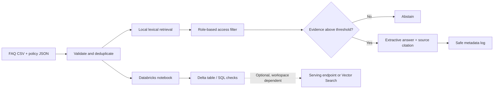

# SupportSense AI — Databricks Customer Support Agent

SupportSense AI is a portfolio/community demo of an evidence-grounded customer-support assistant. It answers from a fictional FAQ collection, cites the source record, filters records by access classification, and abstains when its local retriever cannot find relevant evidence.

> **Community demo only.** This is not a production-certified customer-support system. The included controls and tests are examples, not a guarantee of security, privacy compliance, or correctness. Use fictional data only.

## Problem and goals

Support assistants can confidently provide information that is absent from policy documents or disclose data beyond a user's entitlement. This project keeps the default prototype simple and inspectable: local lexical retrieval, extractive answers copied from approved FAQ content, citations, and a clear unknown-answer response. Databricks notebooks demonstrate how the same data can be validated and stored as Delta tables.

## Architecture



## Features

- Responsive Streamlit chat UI, history, sample prompts, clear-chat, citations, and loading/error states.
- 24 fictional FAQs across the eight requested support categories and a small policy JSON file.
- Local TF-IDF-like lexical ranking; this is a transparent fallback, not semantic search.
- Extractive local response mode works without Databricks, an API key, or paid resources.
- Input length and basic injection/privacy checks, retrieval-time role authorization, suspicious-document filtering, citation IDs, and hashed-question operational logs.
- Ten deterministic local security regression cases and a live evaluation panel.
- Four Databricks notebook source files for Delta ingestion, quality checks, retrieval demonstration, and security checks.
- Cost template distinguishes measured costs from estimates and unknowns.

## Technology

| Area | Local default | Optional cloud path |
|---|---|---|
| UI | Streamlit | Streamlit or separately hosted app |
| Processing | Python standard library | Apache Spark / PySpark |
| Storage | CSV and JSON | Delta tables; Unity Catalog where available |
| Retrieval | TF-IDF-like lexical overlap | Vector Search only when available and provisioned |
| Answer generation | Extractive; no generative model | Configured Databricks serving endpoint |
| Tests | `unittest` | Workspace-specific integration/security checks still required |

No Databricks Free Edition capabilities are assumed. The actual workspace must be checked for each feature, permissions, quotas, and possible charges before enabling it.

## Repository layout

```text
.
├── app.py
├── config.py
├── data/                 # fictional FAQ CSV and policy JSON
├── docs/                 # demo script, talk outline, announcement
├── notebooks/             # Databricks notebook source
├── reports/               # generated security report and cost template
├── src/                   # retrieval, chatbot, security, evaluation, logging
└── tests/                  # standard-library unit tests
```

## Prerequisites and local run

- Python 3.10+ recommended (core modules and tests use only the Python standard library).
- Streamlit is required for the UI.
- No credentials are needed for local mode.

In PowerShell from this directory:

```powershell
python -m venv .venv
.\.venv\Scripts\Activate.ps1
python -m pip install -r requirements.txt
streamlit run app.py
```

The default app does not call a model endpoint. Use sample questions or enter your own non-sensitive question. It does not store conversation history to disk. Logs contain a truncated SHA-256 question identifier and operational metadata, not raw question text.

## Retrieval and answer behavior

The local retriever tokenizes question/category/answer text, applies a small inverse-document-frequency weighting, filters by access classification and suspicious instruction text, then ranks results. The configurable threshold is `RETRIEVAL_THRESHOLD` (default 0.14); `MAX_RETRIEVAL_RESULTS` controls the number returned (default three). Set these in the process environment; the app does not automatically load `.env` files. It is a deliberately small FAQ-level search (no chunking), not embedding similarity. FAQ answers are copied from the highest-ranked document. This makes the local answer directly inspectable, but lexical matching can miss paraphrases and can retrieve misleading overlaps.

When no evidence meets the threshold, the assistant returns: “I couldn’t find that information in the authorized support knowledge base.” The default local role is `public`; it can access only `public` records. The example `support`/`admin` role matrix is for demonstration only: a real deployment must derive identity and permissions server-side from a trusted identity provider and enforce them at the governed data source.

### Optional Databricks model endpoint

Only enable after confirming endpoint availability, data handling, access, quotas, and pricing in your workspace. Use `.env.example` as a variable-name reference and set `DATABRICKS_HOST`, `DATABRICKS_TOKEN`, and `DATABRICKS_SERVING_ENDPOINT` in the process environment or an approved secret manager; the app does not automatically load `.env` files. Never commit credentials. The endpoint call sends the user question and retrieved fictional support context. It uses a bounded request and system instructions but does **not** establish that generated claims are grounded or safe. Review/evaluate endpoint output before a public demonstration. No credentials or endpoint are configured or tested in this workspace.

## Databricks setup and ingestion

1. Confirm your Databricks edition/workspace supports your intended compute, Unity Catalog, Delta, and (optionally) serving/vector features. Check current workspace terms and cost controls; features and included usage vary.
2. Open this repository in Databricks Repos or upload it to an authorized workspace location.
3. Run `notebooks/01_data_ingestion.py`; set the catalog, schema, source CSV path, and table widgets. It validates required columns, normalizes dates/strings, drops invalid rows and duplicate IDs, then writes a Delta table.
4. Run `notebooks/02_data_quality.py` to check required fields, duplicate IDs, blank fields, and access labels.
5. Run `notebooks/03_rag_pipeline.py` for a deliberately simple lexical retrieval demonstration from the table.
6. Run `notebooks/04_ai_security_evaluation.py` for basic workspace-side examples.

Choose catalog/schema/table names permitted by your workspace. The notebooks use no account credentials in source. Databricks notebook execution, Unity Catalog permissions, model serving, and billing cannot be validated without your workspace and authorization. Notebook paths and workspace-specific identity setup may require adjustment.

## Security evaluation and tests

Run the tests and generated report:

```powershell
python -m unittest discover -s tests -v
python -m src.evaluation
```

The test suite covers direct/indirect prompt injection examples, system prompt requests, privacy requests, unsupported questions, access filtering, oversized inputs, cross-user requests, citation identifiers, and unauthorized-action requests. It checks expected local behavior and writes actual outputs to `reports/security_test_report.md`. A passing suite is not proof of security.

**Important limitations:** pattern-based detection misses paraphrases; the local role is a demo parameter rather than authenticated identity; CSV data is not a governed production store; filtering suspicious documents is not a comprehensive prompt-injection defense; model endpoint output is not fact-checked; rate limiting is not implemented in the local Streamlit app; and no production multi-tenant isolation is provided. For real use, add identity-aware authorization at the data layer, ingestion provenance and review, tenant isolation, model output validation, abuse controls, monitoring, retention rules, and independent red-team testing.

## Evaluation dashboard and metric definitions

Run the live checks in the app’s evaluation expander or run the CLI. Displayed metrics are based on that test run, not illustrative benchmark data:

- **Questions tested:** number of executed cases.
- **Answer success rate:** passing cases / all executed cases (test-specific expected behavior, not customer answer quality).
- **Grounded-answer rate:** passed indirect-injection grounding and citation-integrity checks / those checks executed. This is a narrow proxy, not proof that every claim is entailed.
- **Abstention rate:** cases whose actual response is the standard missing-evidence message / all cases.
- **Citation correctness:** citation test pass (1 or 0); IDs must be in the loaded FAQ/policy set.
- **Prompt-injection pass rate:** passed direct/indirect/system-prompt checks / 3.
- **Average response latency:** arithmetic mean observed local case latency in milliseconds.
- **Token usage / estimated model cost:** unavailable in local mode (`-1` sentinel in CLI metrics; not measured). Endpoint usage/cost must be obtained from the serving/workspace billing information.

## Cost tracking

See [reports/cost_report_template.md](reports/cost_report_template.md). No cloud workspace or billing data is available for this project run, so Databricks compute, model inference, storage, and total cloud costs are **unknown, not zero**. Local default mode makes no model API call; local hardware/network costs are not metered. Verify trial/free-tier quotas and potential charges in your actual workspace before creating resources.

## Demo, presentation, and portfolio material

- [docs/demo_script.md](docs/demo_script.md) — five-minute setup and scenarios.
- [docs/community_presentation.md](docs/community_presentation.md) — timed Kathmandu Databricks community outline.
- [docs/linkedin_announcement.md](docs/linkedin_announcement.md) — editable announcement draft.
- `screenshots/` is intentionally empty until you capture actual UI screenshots; no fabricated screenshots are included.

## Test evidence and limitations

Test status is the result of running the commands above in the environment used for this project. Re-run them after changes; the generated security report captures actual outcomes. Databricks cloud behavior and optional model endpoint are not claimed as tested. See [reports/security_test_report.md](reports/security_test_report.md) for the latest generated observations and scope limits.

## Future improvements

- Compare lexical retrieval with Databricks Vector Search or another embedding retriever using labeled relevance examples.
- Use authenticated identity and Unity Catalog grants end-to-end, including tenant-aware test cases.
- Add claim-level evidence checking, citation validation for generated output, and human escalation.
- Add a production-grade rate limiter, structured retention settings, monitoring, and model-cost accounting.
- Validate notebook paths and data-quality policy with the target workspace and add integration tests there.
